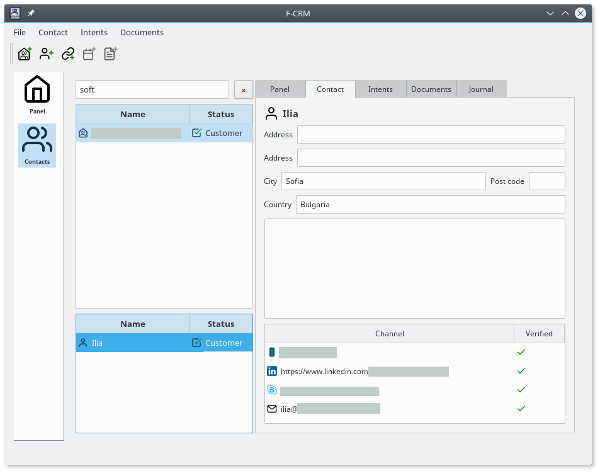

# F-CRM

**Customer Relationship Management** for Freelancers and Individual Contractors.

  Screenshot from Debian Linux

# Why?

I am a freelancer. I need professional relations with my clients. This requires a system where all contact information, documents, emails, calls — *everything* — is easily available when I need it.

# Backstory

I spent a full day trying to find a suitable solution. I looked for an open-source, or at least affordable, desktop application. Nothing. Everything is *cloud* these days. It’s just that — *I don’t want cloud*. Cloud services are fragile. They may go down. They may get acquired and shut down. They may simply *terminate your service for any reason or no reason at all*. **There is no cloud!** It’s just someone else’s computer. I like dependable applications. They’re faster to work with, have a richer set of UI controls, and they work whether the Internet is available or not.

I did try [odoo](https://www.odoo.com/) CRM and Sales modules, installing the backend on my own server. Odoo is very popular. It’s an impressive project — but the CRM capabilities are too limited for my use.

So, I decided to code a good desktop CRM application from scratch in *one* week. One week later, Friday the 23rd of 2018, I downloaded the binary .deb package from my build server, installed it on my PC, and started to use it.

# Features

The application is dead simple, with just the complexity and features a high-value freelancer needs to do a brilliant job with sales and customer relations.

* **Contact management** (companies or private persons).
* **Contact person management** at the companies.
* **Intents** (pipelines) — mini-projects with clearly defined goals that you want to achieve. For example, selling something to, or getting the attention of, a prospect.
* **Actions** — steps/tasks to perform to move an intent forward toward completion. For example, sending a follow-up email on a specific date.
* **Document management** — documents and emails are linked to customers, persons, intents, or actions.
* **Journal** — a list of all the relevant things that have happened within the relationship with a contact. This is updated automatically when you add or change information.
* **Data is stored locally** in a SQLite database.
* **Integration with email clients** so that we can send and view sent/received emails directly from *f-crm*. Currently, Thunderbird is tested.

# Supported platforms

**TBD**

# Prebuilt binaries

**TBD**

# How to build

# Current status

Upgrading to Qt 6.10

